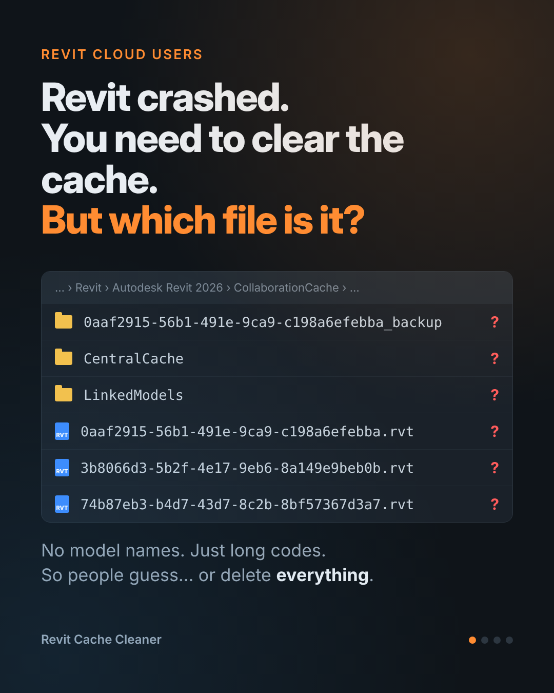
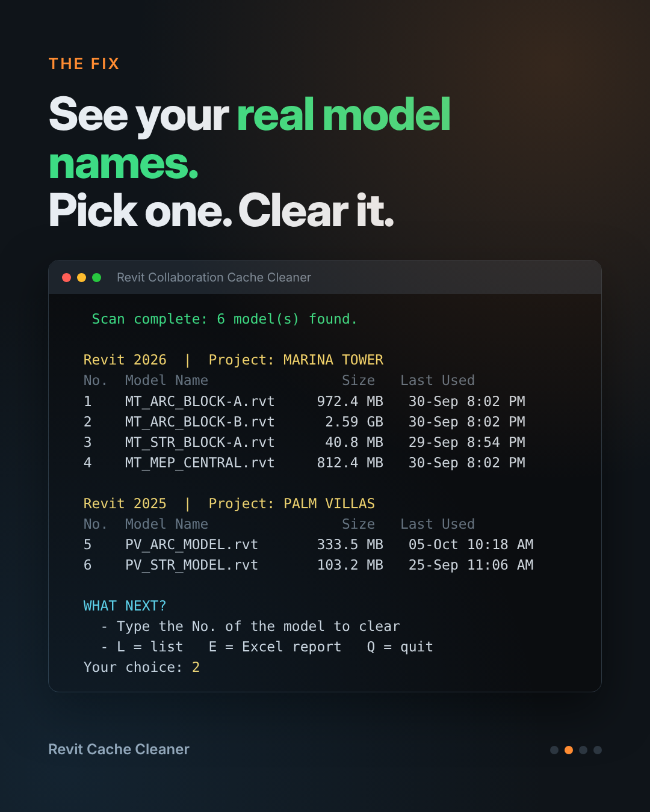
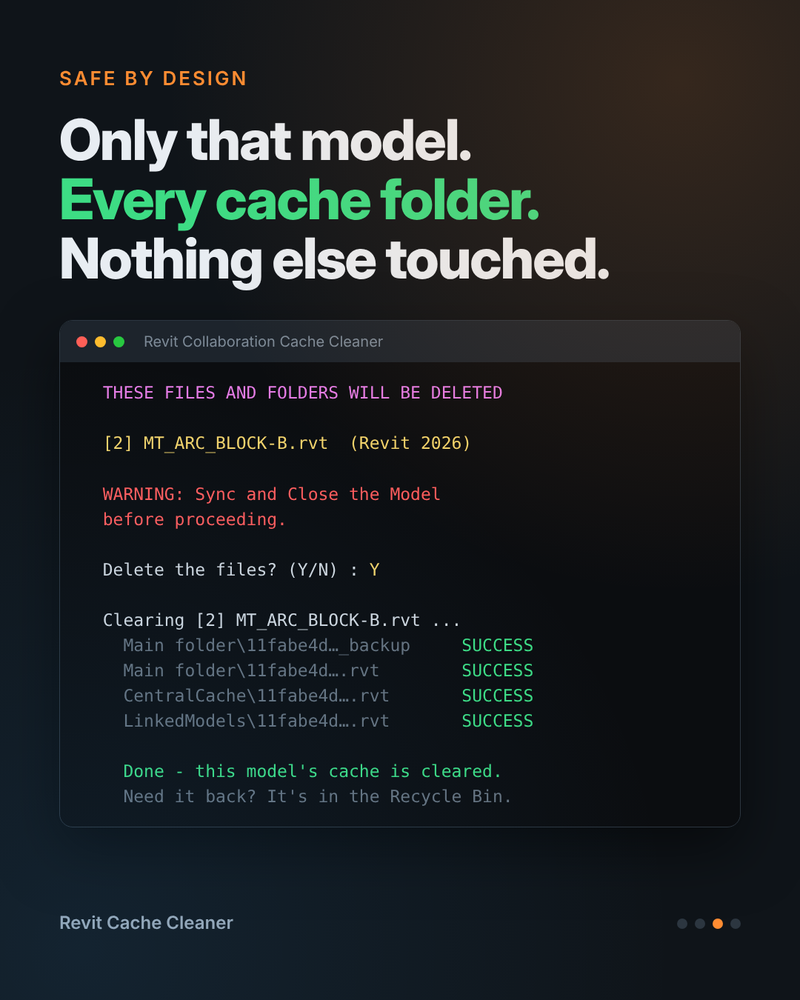

# Revit Cache Cleaner

**Clear the Collaboration Cache of ONE Revit cloud model — by its real name.**

When a Revit cloud model (BIM 360 / ACC / Autodesk Docs) keeps crashing or won't open, the usual fix is to clear its Collaboration Cache. But that folder only shows long codes like `0aaf2915-56b1-491e-9ca9-c198a6efebba.rvt` — no model names. So people guess, or delete the whole cache and re-download every model.

This tool shows you the **real model names**, lets you pick one by number, and clears **only that model's** cache — safely.

---

## ✅ What it does

- Scans your Revit Collaboration Cache automatically (all Revit versions on the PC)
- Shows the **real model names**, grouped by **project** and **Revit version**
- Clears the chosen model from **every** cache folder: main folder, `CentralCache` and `LinkedModels`
- Sends files to the **Recycle Bin** (not permanent delete) — you can always restore them
- Optional **Excel report** of everything in your cache

---

## 🚀 How to use

1. **Sync and close** your Revit model.
2. Download **`Revit_Cache_Cleaner.bat`** (see *Download* below).
3. **Double-click** it.
4. Press **Enter** to scan (or paste a CollaborationCache folder path).
5. Type the **number** of the model to clear — e.g. `3`, `3,5` or `3-6`.
6. Type **Y** to confirm.
7. Open the model again from Autodesk Docs — Revit downloads a fresh copy.

| Key | Action |
|---|---|
| Number | Clear that model's cache |
| `L` | Show the list again |
| `E` | Create an Excel report (saved to Desktop) |
| `Q` | Quit |

---

## 🛡️ Safety

- ⚠️ **Always Sync and Close the model first.** Work that is not synced to the cloud is only in your local copy.
- Checks that **Revit is closed** before deleting anything.
- Shows **exactly which files** will be removed and asks **Y/N** first.
- Files go to the **Recycle Bin**. If a file is too big for the Recycle Bin, Windows asks before deleting it permanently.
- Other models are **not touched**.
- A record of every clean-up is saved in `Documents\Revit_Cache_Cleaner_Log.txt`.

---

## 📥 Download

Go to **[Releases](../../releases)** and download the latest `.zip`, or open `Revit_Cache_Cleaner.bat` above and click **Download raw file**.

> Some companies block `.bat` files downloaded from the internet. If so, ask your IT team to review it — the file is plain text and can be read in Notepad (right-click → **Edit**).

---

## ❓ FAQ

**How does it know the real model name?**
Each cached `.rvt` file stores its cloud path (e.g. `Autodesk Docs://Project/Model.rvt`) inside it. The tool reads that text. It does not open Revit or change the file.

**Which Revit versions are supported?**
Tested on **Revit 2026**. It scans all installed versions; feedback on other versions is welcome.

**Does it need installing or admin rights?**
No. It is one file. It uses Windows PowerShell, which is built into Windows.

**Does it work on Mac?**
No — Windows only (like Revit).

---

## 📋 Requirements

- Windows 10 or 11
- Revit with cloud worksharing (BIM 360 / ACC / Autodesk Docs)

---

## ⚖️ Disclaimer

Free to use **at your own risk**. Always sync your work before clearing the cache.
This project is not made by, endorsed by, or affiliated with Autodesk. *Revit*, *BIM 360* and *Autodesk Docs* are trademarks of Autodesk, Inc.

## 📄 License

[MIT](LICENSE)
